# D&D5e ココフォリア変換 マニュアル

[D&D5e ユドナリウムPCコマ生成ツール](https://unib-5e-udonarium-pc.onrender.com/)（うにバター氏作）で保存したユドナリウムのコマを、
[ココフォリア](https://ccfolia.com/) に貼り付けられるキャラクターデータへ変換するツールの使い方です。

- 公開ページ: https://kenken-trpg.github.io/dnd5e-udonarium-to-ccfolia/
- **[動画マニュアル（YouTube・約1分30秒）](https://www.youtube.com/watch?v=qQDg6C3P3Zo)**: キャラクターシートからココフォリアに貼り付けるまでの流れを、実際の画面で紹介しています。

画面の **?** や主なボタンにマウスを乗せる（スマホは **?** をタップする）と、その項目の説明が出ます（[画面の説明（ツールチップ）](#画面の説明ツールチップ)）。

---

## 1. コマを用意する

1. [D&D5E キャラクターデータベース](https://dndjp.sakura.ne.jp/LIST.php) で自分のキャラクターシートを開き、
   アドレス（`https://dndjp.sakura.ne.jp/OUTPUT.php?ID=…`）をコピーします。
2. [D&D5e ユドナリウムPCコマ生成ツール](https://unib-5e-udonarium-pc.onrender.com/) の入力欄にアドレスを貼り付け、「**生成する**」を押してZIPを保存します。

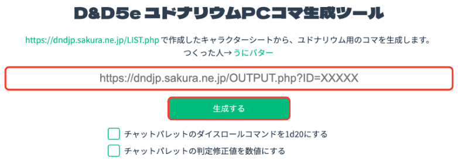

ZIPは展開しなくてかまいません。展開した場合は、中のXMLファイルを読み込ませても同じです。

## 2. 変換する

### 公開ページで使う

1. [公開ページ](https://kenken-trpg.github.io/dnd5e-udonarium-to-ccfolia/) を開きます。
2. 保存したZIPを「2. 読み込む」の枠にドロップするか、枠をクリックして選びます。
   - 複数のファイルを一度に選ぶと、全員分をまとめて変換します。
   - 新しく読み込むと、前の結果は消えて置き換わります。
3. 必要なら「3. 出力オプション」を変えます（[オプション](#出力オプション)）。変えるとすぐ結果に反映されます。
   選んだオプションはブラウザに記憶され、次に開いたときも同じになります。
4. キャラクターごとに出る「**ココフォリア用にコピー**」を押します。

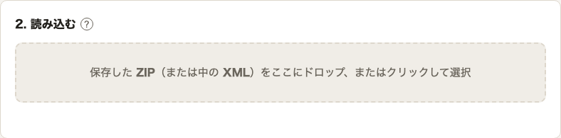

変換すると、次のようにキャラクターごとの結果が表示されます。「ココフォリア用にコピー」で貼り付け用のデータをコピーしてください。
画面はサンプルデータの変換例です。

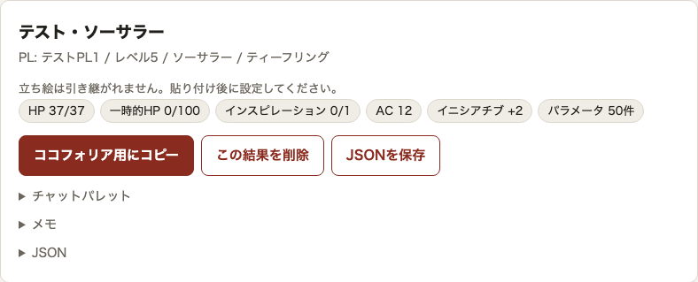

コピーできると、ボタンが「**コピーしました ✓**」に変わり、読み込み欄の下に「『（名前）』をコピーしました。」と表示されます。
続けて[ココフォリアに貼り付け](#3-ココフォリアに貼り付ける)てください。

結果の下の「チャットパレット」「メモ」「JSON」を押すと、貼り付ける内容をその場で確認できます。もう一度押すと閉じます。

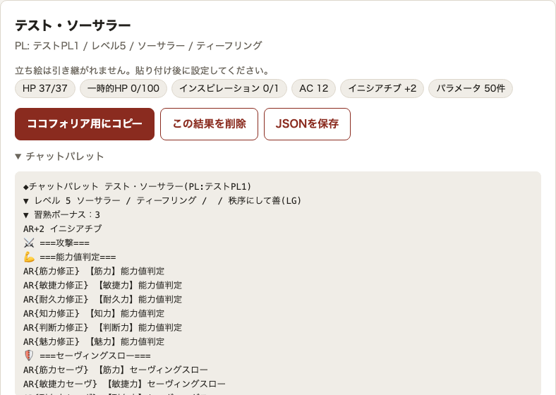

### 手元で使う（ダウンロード版）

公開ページの下にある「**ZIPをダウンロード**」から、手元で使う版を保存できます。
展開した `dnd5e-ccfolia` フォルダの `index.html` をダブルクリックすると、公開ページと同じように使えます（インターネットにつながっていなくても動きます）。
フォルダの中の `index.html`・`app.js`・`converter.js`・`archive.js`・`style.css`・`manual.html` と `images` フォルダは、同じフォルダに置いたままにしてください。
画面下の「マニュアル」から、この説明をネット接続なしで読めます。動画マニュアルや外部サービスへのリンクを開くときは接続が必要です。

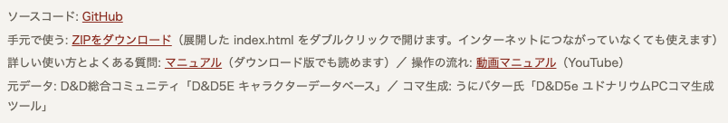

### 読み込み状況とキャンセル

読み込み中は「3 / 12ファイルを読み込み中」のような進捗と、ファイルごとの状態が表示されます。
「読み込みをキャンセル」を押すと、変換済みの結果は残り、未処理のファイルやXMLの読み込みを中断します。
処理中のファイルの読み取り・ZIP展開・XML解析そのものは、終了を待つ場合がありますが、中断後に古い結果を追加することはありません。
新しいファイルを選び直した場合も古い読み込みを中断し、新しい結果に置き換えます。

ファイルごとの状態は「待機中」「読み込み中」「成功」「一部成功」「失敗」「中断」です。
ZIP内のXMLが一部だけ読めない場合、正常なXMLから変換したキャラクターはそのまま使えます。
エラーには該当するファイル名やZIP内のXML名を表示します。

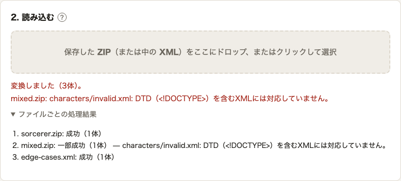

### 結果の整理と一括保存

変換結果の上に、表示中の体数と、全員分をまとめて扱うボタンが出ます。

- 「この結果を削除」でキャラクターを1体ずつ結果から外せます。
- 「すべてクリア」で読み込みを中断し、結果とファイルごとの状態を消します。記憶した出力オプションは残ります。
- 「全員分をZIPで保存」で、現在表示されているキャラクターごとのJSONをまとめて保存できます。読み込みが完了または中断すると使えます。
- 同名のキャラクターはファイル名に連番を付けます。パス区切りなどの使えない文字は置き換えます。キャラクターの名前や値自体は変更しません。

ZIPはバックアップ用です。展開したJSONをテキストエディタで開き、内容をコピーして1体ずつココフォリアに貼り付けてください。
一括ZIPの出力上限は64MBです。ZIPは無圧縮なので、JSONをそのまま格納した大きさになります。
ファイルごとの状態は読み込み時の記録です。個別削除後の体数は「変換結果」の体数で確認してください。

### 貼り付け前の確認

- 未解決の `{参照}` があると、行番号付きで表示します。行番号を押すとパレットの該当行を開き、強調表示します。案内は先頭20行までで、全体はパレットやJSONでも確認できます。
- ステータスとパラメータの名前が重複している場合、件数を表示します。同名の参照先が曖昧になるため、元データを確認してください。
- 各結果に、立ち絵を引き継がないことと、背景などのメモを出力していない場合の案内を表示します。

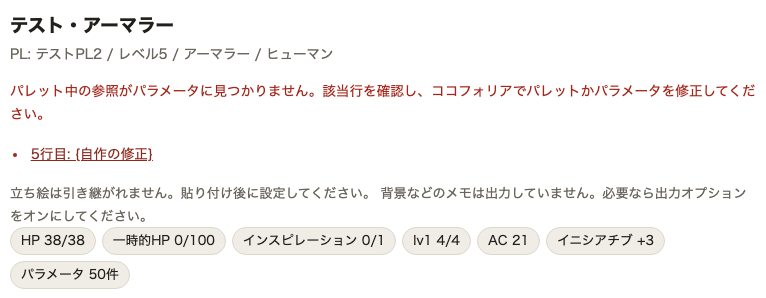

警告は確認のための案内です。元の値を自動修正したり、重複した項目を削除したりしません。

## 3. ココフォリアに貼り付ける

1. ココフォリアのルームを開き、**盤面を一度クリック**します。
2. `Ctrl+V`（Mac は `⌘+V`）を押すと、キャラクターのコマができます。

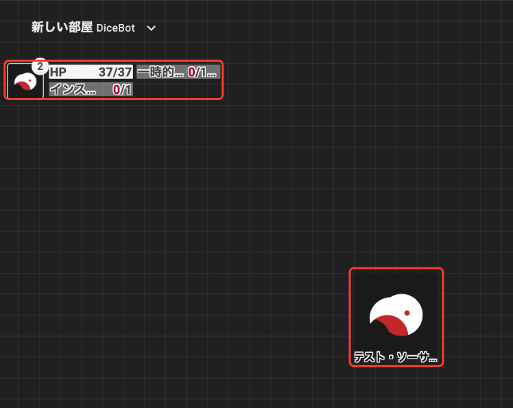

3. ルームのダイスボットを「**ダンジョンズ＆ドラゴンズ第5版**」にすると、チャットパレットの `AR` / `AT` コマンドが使えます。

ココフォリアの画面は2026年11月時点のものです。ココフォリアの更新で見た目が変わることがあります。
操作の流れは[動画マニュアル](https://www.youtube.com/watch?v=qQDg6C3P3Zo)でも確認できます。

### 立ち絵（コマの画像）を設定する

立ち絵（画像）は引き継がれません。貼り付けたあと、ココフォリアで次のように設定してください。

1. コマを右クリックし、「**編集**」を選びます。

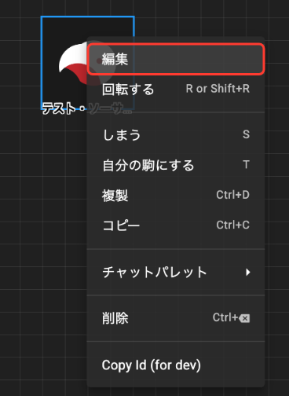

2. 「キャラクター編集」が開いたら、名前の左にある丸い画像をクリックします。

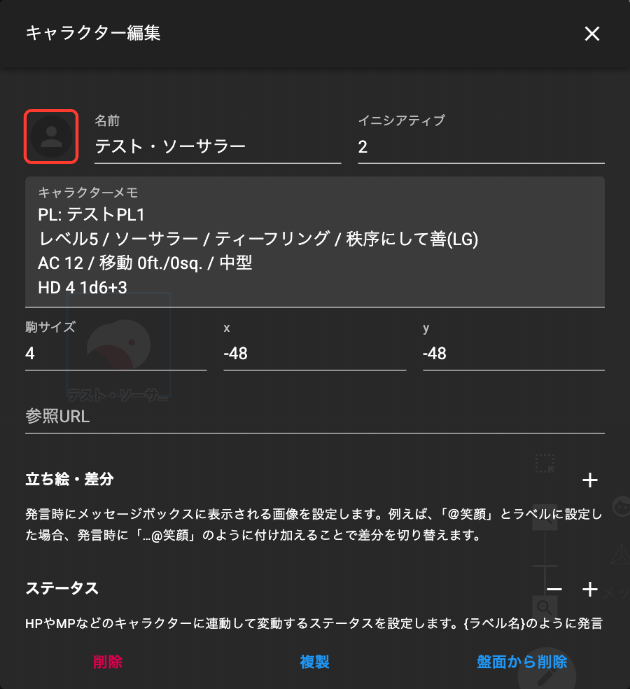

3. 画像の一覧で右上の「**+**」を押して画像をアップロードし、アップロードした画像をクリックして選びます。

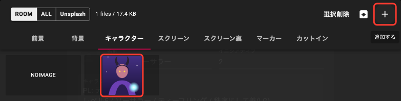

4. 「キャラクター編集」を閉じると、コマとステータスの欄に画像が表示されます。

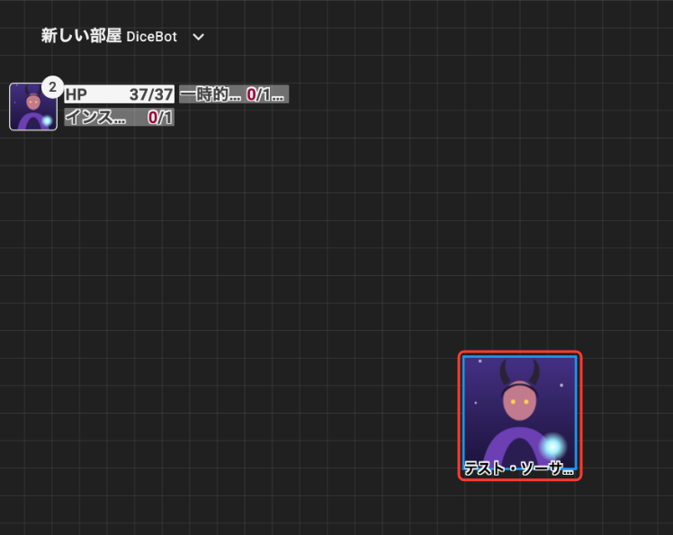

---

## 画面の説明（ツールチップ）

次の場所にマウスを乗せると説明が出ます。説明の上にマウスを動かしても消えないので、拡大表示していても読めます。

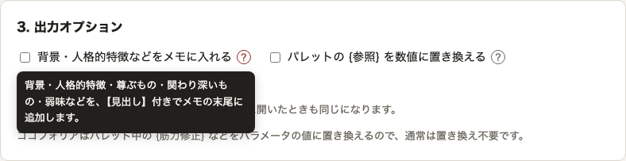

| 場所 | 説明の内容 |
|---|---|
| 「2. 読み込む」の **?** | 読み込めるファイルと上限 |
| 出力オプションの **?** | 各オプションの効果 |
| 「読み込みをキャンセル」 | 中断しても変換済みの結果が残ること |
| 「全員分をZIPで保存」「すべてクリア」 | 保存されるもの・消えるもの |
| 結果の概要（HP などの欄） | ステータスとパラメータの違い |
| 「ココフォリア用にコピー」「この結果を削除」「JSONを保存」 | 各ボタンの働き |

- **キーボード**: Tab で項目やボタンに移動すると表示されます。画面読み上げソフトでは、項目の説明として読み上げられます。
- **スマホ**: **?** をタップすると表示され、画面のほかの場所をタップすると閉じます。
- **閉じる**: Esc で閉じます。もう一度マウスを乗せるか、移動し直すと表示されます。
- 画面の端では、はみ出さないように左や上にずらして表示します。

## 出力オプション

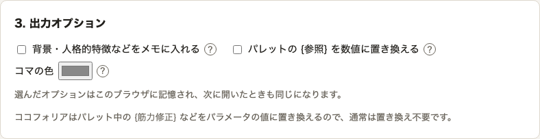

| オプション | 内容 |
|---|---|
| 背景・人格的特徴などをメモに入れる | 背景・人格的特徴・尊ぶもの・関わり深いもの・弱味などを、【見出し】付きでメモの末尾に追加します。 |
| パレットの {参照} を数値に置き換える | `{筋力修正}` などを、変換した時点の数値に置き換えます。ココフォリアは `{参照}` をパラメータの値に置き換えて振るので、**通常はオフのままで構いません**。オンにすると、あとでココフォリア上のパラメータを書き換えてもパレットは変わらなくなります。 |
| コマの色 | ココフォリアのキャラクター設定の「色」に入ります。 |

オプションはブラウザに記憶されます（プライベートウィンドウなどでは記憶されません）。

## 変換内容

| ユドナリウム | ココフォリア |
|---|---|
| HP、一時的HP、インスピレーション、使用する呪文スロット（lv1〜lv9） | ステータス（現在値 / 最大値） |
| その他の値（能力値、能力値修正、技能、セーヴ、AC、習熟ボーナスなど） | パラメータ |
| チャットパレット | チャットパレット（そのまま） |
| イニシアチブ | イニシアチブ値 |
| PL、レベル、クラス、種族、属性、AC、移動速度、サイズ、HD、呪文セーヴDC、呪文攻撃 | メモ |
| 特徴等（背景、人格的特徴ほか） | メモ（オプション） |
| 画像 | 持ち込まない |

- 値が空の呪文スロット（そのレベルの呪文を使わない場合）は、ステータスに出しません。
- 呪文名の一覧はパラメータにしません。

---

## よくある質問・困ったとき

### Streamlit版（…streamlit.app）はどうなりましたか

終了しました。同じ変換は、このマニュアルで説明している[公開ページ](https://kenken-trpg.github.io/dnd5e-udonarium-to-ccfolia/)でできます。
公開ページはファイルをどこにも送信しないぶん、Streamlit版より安全です。

### 「ZIP内にユドナリウムのキャラクターXMLが見つかりませんでした。」と出る

生成ツールで保存したZIPではない可能性があります。生成ツールでもう一度生成・保存してください。

### 「XMLの解析に失敗しました。」と出る

ファイルが途中までしか保存されていないか、別の形式のファイルです。生成ツールで保存し直してください。

### 「ファイルが大きすぎます」「ZIP内のファイルが多すぎます」と出る

生成ツールのZIPは数KB程度です。別のファイルを選んでいないか確かめてください（[上限](#上限)）。

### 「パレット中の参照がパラメータに見つかりません」と出る

チャットパレットに書かれた `{名前}` のうち、同じ名前のパラメータが無いものがあります。
ココフォリアではその部分が数値に置き換わらないので、貼り付けたあとにパレットかパラメータを直してください。
生成ツールが出力したままのデータでは通常は出ません。

### 「コピーしました」と出たのに貼り付けられない／コピーできないと出る

- 貼り付ける前に、ココフォリアの**盤面をクリック**してください。チャット欄などに文字入力のカーソルがあると、そちらに文字として貼り付きます。
- ブラウザがクリップボードへの書き込みを止めている場合は、結果の「JSON」を開いて中身をすべて選択してコピーするか、
  「JSONを保存」で保存したファイルをテキストエディタで開いてコピーしてください。

### 読み込みが終わらない・画面が固まった

「読み込みをキャンセル」を押してから、ファイルを分けて読み込んでください。生成ツールのZIPは数KBなので、通常は一瞬で終わります。
大きなファイル（数MB以上）を選んでいる場合は、別のファイルを選んでいないか確かめてください。

### 説明（ツールチップ）が邪魔で下のボタンを押せない

Esc で閉じるか、マウスを説明の外へ動かしてください。

### 前に貼り付けたコマを更新したい

貼り付けるたびに新しいコマができます。前のコマはココフォリア上で削除してください。

### キャラクターシートの内容がココフォリアに反映されない

このツールは生成ツールが作ったコマを変換するだけです。キャラクターシートを更新したら、生成ツールでコマを作り直してから変換してください。

---

## プライバシーと安全性

- 変換はすべてブラウザの中で行い、ファイルはどこにも送信しません。
  ページ自体が外部へ通信できない設定（Content Security Policy の `connect-src 'none'`）になっています。
  ファイルの内容はHTMLとして解釈せず、文字として表示します。ファイルにHTMLやスクリプトが書かれていても実行されません
  （対応ブラウザでは、Trusted Types の設定でHTMLの組み立て自体も禁止しています）。
  公開ページのほか、[ダウンロード版](#手元で使うダウンロード版)を展開した `index.html` をダブルクリックで開いても使えます。
  記憶するのは出力オプションだけで、読み込んだファイルやキャラクターの内容は保存しません。
- 生成ツールのサーバーにも接続しません。

## 上限

壊れたファイルや悪意のあるファイルでブラウザやサーバーが固まらないよう、次の上限があります。通常のコマでは超えません。

| 項目 | 上限 |
|---|---|
| 読み込むファイル1つの大きさ | 20MB |
| 1回に選択するファイル数・変換するキャラクター数 | 50ファイル・50体 |
| 1回に選択するファイルの合計 | 20MB |
| ZIP全体・1回の読み込みで展開するXMLの合計 | 20MB |
| ZIP内のファイル数 | 1000個 |
| キャラクターXML1つ（直接読み込む場合も同じ）の大きさ | 5MB |

DTD（`<!DOCTYPE>`）を含むXMLは読み込みません（ユドナリウムは出力しません）。
